# ZAI CRM Enterprise V1.0 — Árvore Completa de Telas, Botões, Ações e Arquitetura

Este documento mapeia a **Árvore de Diretórios Ramificada (V1)** e a **Árvore de Telas, Submenus, Botões, Seletores e Contratos de API** do ZAI CRM Enterprise. Seu objetivo é permitir que engenheiros e agentes naveguem, depurem e evoluam qualquer tela ou ação em segundos.

---

## 1. Árvore de Diretórios Ramificada (V1.0 Clean Root)

A raiz do monorepo foi higienizada e organizada em ramificações claras para eliminar arquivos temporários soltos e facilitar a visualização completa da arquitetura:

```text
ZAPAI-FINAL/
├── backend/                          # API REST, Socket.IO, Baileys WhatsApp, Fila Outbound e Motor IA
│   ├── src/
│   │   ├── api/
│   │   │   ├── controllers/          # Controllers HTTP (aiAgentsController, inboxController, etc.)
│   │   │   ├── middlewares/          # Autenticação JWT, RBAC, Tenant Isolation, Rate Limit
│   │   │   └── routes/               # Definição das rotas Express (/api/*)
│   │   ├── ai/                       # Motor Evolutivo, Prompt Builder, Delay Engine, Memória
│   │   ├── repositories/             # Acesso PostgreSQL isolado por tenant/store
│   │   ├── services/                 # Serviços de domínio (WhatsApp Baileys, Campanhas, CRM)
│   │   └── workers/                  # Filas assíncronas e disparos humanizados
│   ├── migrations/                   # Migrações SQL numeradas
│   └── tests/                        # Testes de integração e contrato do backend
├── frontend-official/                # Aplicação React 18 + Vite + Tailwind + Phosphor Icons
│   ├── public/
│   │   └── assets/avatar_factory/    # Sprites 2.5D limpos (catalog/sprite_r*_c*_clean.png)
│   ├── src/
│   │   ├── components/
│   │   │   ├── ai/                   # ZaibotFloatingAssistant, ZaiPlatformAssistantView
│   │   │   ├── attendants/           # AttendantItemCard, AddAttendantCard, exampleAttendants
│   │   │   ├── avatar-engine/        # ZaiAvatarRenderer, AvatarItemPreview, AvatarEditorModal, CharacterFactory
│   │   │   ├── evolution/            # ActiveBrainGraph, MemoryDetailDrawer, EvolutionCenter
│   │   │   ├── layout/               # Sidebar, Header, MobileBottomNav, CanonicalShell
│   │   │   └── ui/                   # Design System primitivos (Button, Dialog, Pagination, Tooltip)
│   │   ├── core/                     # apiService.ts, socketService.ts, utilitários
│   │   ├── pages/                    # Telas canônicas (Dashboard, Inbox, Attendants, Campaigns, Connections, Contacts, Settings)
│   │   ├── state/                    # Stores Zustand (appStore) e hooks de autenticação/sessão
│   │   └── test/                     # Suítes Vitest de unidade e integração
├── data/                             # Dados operacionais locais (isolados do código-fonte)
│   ├── logs/                         # Logs de execução local (backend.log, frontend.log)
│   └── uploads/                      # Mídias e anexos locais
├── deploy/                           # Manifestos Docker, Nginx/OpenResty, PM2 e systemd
├── docs/                             # Documentação ramificada por domínio
│   ├── architecture/                 # SYSTEM_UI_AND_ACTION_TREE.md, ARCHITECTURE.md, API.md, SECURITY.md
│   ├── ops/                          # DEPLOY.md, OPERATIONS.md, OBSERVABILITY.md, TROUBLESHOOTING.md
│   ├── releases/                     # V1.0.0_RELEASE_MANIFEST.md, V1_CLICK_TREE_REPORT.json, screenshots/
│   └── archive/                      # Histórico de auditorias e relatórios anteriores
├── graphify-out/                     # Grafo de arquitetura e SYSTEM_MAP.md
├── scripts/                          # Scripts oficiais de ciclo de vida, QA e deploy
│   ├── runtime-start.mjs             # Inicialização oficial do ambiente (portas 4025 / 8080)
│   ├── runtime-stop.mjs              # Encerramento limpo de processos
│   ├── runtime-clean.mjs             # Limpeza de portas e artefatos temporários
│   ├── deploy-master.js              # Pipeline de deploy para VPS
│   └── qa/                           # Suítes de auditoria e verificação automatizada
│       ├── verify-click-tree.cjs     # Verificador automatizado de cliques em todas as telas e botões
│       └── reorganize-v1-hygiene.cjs # Higienizador estrutural do repositório
└── outros/                           # Arquivo morto ignorado pelo Git (scripts legados, dumps, scratch)
    ├── dumps/
    └── scripts-archive/              # 178 scripts ad-hoc arquivados em {captures,diagnostics,fixes,verifications}
```

---

## 2. Árvore de Telas, Botões e Ações (UI & Action Click Tree)

```mermaid
flowchart TD
  App["App.tsx (Router Principal)"]
  App --> Auth["/login (AdminAuth)"]
  App --> Shell["Application Shell (Sidebar 240px + Header 56px)"]

  Shell --> R_Dash["/dashboard (DashboardView.tsx)"]
  Shell --> R_Inbox["/inbox (Inbox.tsx)"]
  Shell --> R_Att["/attendants (AttendantsPage.tsx)"]
  Shell --> R_Conn["/connections (Connections.tsx)"]
  Shell --> R_Camp["/campaigns (Campaigns.tsx)"]
  Shell --> R_Cont["/contacts (Contacts.tsx)"]
  Shell --> R_Sett["/settings (Settings.tsx)"]
  Shell --> R_Zai["Botão Flutuante Global (ZaibotFloatingAssistant.tsx)"]

  R_Dash --> D_Hub1["Hub 1: Visão Executiva (KPIs, Fluxo, Funil, Temperatura)"]
  R_Dash --> D_Hub2["Hub 2: Mapa Inteligente (Densidade Neon & Cidades)"]

  R_Inbox --> I_List["Coluna 1: Lista de Conversas + Filtros (Todos, Não lidos, IA, Grupos)"]
  R_Inbox --> I_Chat["Coluna 2: ActiveChatPane (Mensagens, Áudio PTT, Gerar Ficha, Composer)"]
  R_Inbox --> I_Side["Coluna 3: SidebarPanel (4 Abas)"]
  I_Side --> I_T1["Aba 1: Atendimento & Cliente"]
  I_Side --> I_T2["Aba 2: Respostas Rápidas"]
  I_Side --> I_T3["Aba 3: Arquivos & Mídia"]
  I_Side --> I_T4["Aba 4: Logs & Histórico"]

  R_Att --> A_Cards["Topo: Carrossel de Atendentes Reais + Card [+ Novo Atendente] + Modelos Exemplo"]
  R_Att --> A_KPIs["Faixa Diária: Respostas IA hoje | Tokens hoje | Conversas hoje | Leads hoje"]
  R_Att --> A_Sub1["Submenu 1: Atendente IA (Avatar Studio 2.5D + Chat de Teste Real)"]
  R_Att --> A_Sub2["Submenu 2: Configuração (Objetivo, Tom, Prompt, Provedores, Vínculos WhatsApp)"]
  R_Att --> A_Sub3["Submenu 3: Memória & Evolução (Cérebro Ativo, Memórias, Linha do Tempo, Evolução)"]
  R_Att --> A_Sub4["Aba ?tab=copilot: Assistente ZAI (ZaiPlatformAssistantView)"]
```



---

## 3. Mapa Detalhado de Botões, Seletores DOM e Handlers por Tela

### 3.1. Atendentes IA & Avatar Studio 2.5D (`/attendants`)
- **Arquivo Principal**: [`frontend-official/src/pages/Attendants/AttendantsPage.tsx`](file:///c:/projetos/ZAPAI-FINAL/frontend-official/src/pages/Attendants/AttendantsPage.tsx)
- **Motor Visual**: [`frontend-official/src/components/avatar-engine/ZaiAvatarRenderer.tsx`](file:///c:/projetos/ZAPAI-FINAL/frontend-official/src/components/avatar-engine/ZaiAvatarRenderer.tsx)
- **Miniaturas com Recorte SVG (`cropFocus`)**: [`frontend-official/src/components/avatar-engine/AvatarItemPreview.tsx`](file:///c:/projetos/ZAPAI-FINAL/frontend-official/src/components/avatar-engine/AvatarItemPreview.tsx)

| Grupo / Região | Botão / Controle | Seletor DOM / Atributo | Ação / Efeito no Sistema |
| :--- | :--- | :--- | :--- |
| **Topo: Seleção** | Card de Atendente Real | `[data-agent-key="<key>"]` | Seleciona o atendente ativo (`handleSelectAgent`) e sincroniza loja/WhatsApp. |
| **Topo: Seleção** | Botão `Editar` no Card | `button:has-text("Editar")` | Abre o editor do atendente selecionado. |
| **Topo: Seleção** | Card `+ Novo Atendente` | `AddAttendantCard button` | Abre `NewAgentWizardModal` para criação guiada de funcionário digital. |
| **Topo: Seleção** | Card de Modelo (`EXEMPLO`) | `button:has-text("Ver Modelo")` | Carrega visualização de modelo sem persistir como agente real. |
| **Navegação** | Submenu `Atendente IA` | `button:has-text("Atendente IA")` | Exibe o workspace principal (Avatar Studio 2.5D + Chat de Teste). |
| **Navegação** | Submenu `Configuração` | `button:has-text("Configuração")` | Exibe diretrizes comerciais, objetivo, tom, prompt e vínculos de WhatsApp. |
| **Navegação** | Submenu `Memória & Evolução` | `button:has-text("Memória & Evolução")` | Exibe o Cérebro Ativo (grafo interativo) e memórias aprendidas. |
| **Palco 2.5D** | Género `♀ Fem` | `[data-studio-gender="female"]` | Alterna base corporal para feminina e recalibra sprite/paleta. |
| **Palco 2.5D** | Género `♂ Masc` | `[data-studio-gender="male"]` | Alterna base corporal para masculina e recalibra sprite/paleta. |
| **Turntable 3D** | `⟲ Girar Esq` | `[data-studio-3d="rotate-left"]` | Rotaciona o personagem em `-45°` no eixo Y (`rotationY`). |
| **Turntable 3D** | `Frente 0°` | `[data-studio-3d="front"]` | Enquadra o personagem de frente (`rotationY = 0°`). |
| **Turntable 3D** | `Perfil 90°` | `[data-studio-3d="profile"]` | Alterna entre perfil direito (`90°`) e perfil esquerdo (`270°`). |
| **Turntable 3D** | `Costas 180°` | `[data-studio-3d="back"]` | Renderiza visão traseira 180° (`#layer-hair-back-view` + `#layer-outfit-back-cover`). |
| **Turntable 3D** | `Girar Dir ⟳` | `[data-studio-3d="rotate-right"]` | Rotaciona o personagem em `+45°` no eixo Y (`rotationY`). |
| **Movimento 3D** | `Andar 3D` / `Acenar 3D` / `Giro 360°` | `[data-studio-movement="walk\|wave\|spin360"]` | Ativa animação contínua de caminhada, aceno ou rotação 360° no palco. |
| **5 Categorias** | Abas `Cabelo`, `Rosto`, `Roupa`, `Acessórios`, `Estilo` | `button:has-text("<Categoria>")` | Alterna o catálogo de itens do Studio com preview instantâneo em camadas. |
| **Persistência** | Botão `Salvar` | `button:has-text("Salvar")` | Persiste `avatarConfig` via `PUT /api/ai/agents/:key/avatar` e `localStorage`. |
| **Chat de Teste** | Input + Botão `Enviar` | `form button[type="submit"]` | Executa `POST /api/ai/test` com o contexto real da loja e do atendente. |

---

### 3.2. Memória & Evolução (`ActiveBrainGraph` + `MemoryDetailDrawer`)
- **Arquivos**:
  - [`frontend-official/src/components/evolution/ActiveBrainGraph.tsx`](file:///c:/projetos/ZAPAI-FINAL/frontend-official/src/components/evolution/ActiveBrainGraph.tsx)
  - [`frontend-official/src/components/evolution/MemoryDetailDrawer.tsx`](file:///c:/projetos/ZAPAI-FINAL/frontend-official/src/components/evolution/MemoryDetailDrawer.tsx)

| Sub-aba / Componente | Botão / Controle | Seletor DOM | Ação / Efeito |
| :--- | :--- | :--- | :--- |
| **Sub-abas** | `Cérebro Ativo` | `button:has-text("Cérebro Ativo")` | Exibe o grafo neural interativo com altura controlada (`500–600px`). |
| **Sub-abas** | `Memórias Relevantes` | `button:has-text("Memórias Relevantes")` | Lista paginada (`<Pagination />`, 10 por página) com busca e filtro. |
| **Sub-abas** | `Linha do Tempo` | `button:has-text("Linha do Tempo")` | Histórico cronológico de eventos e aprendizados. |
| **Sub-abas** | `Evolução Cognitiva` | `button:has-text("Evolução Cognitiva")` | Indicadores de nível, XP, qualidade, assertividade e lacunas. |
| **Grafo** | Zoom `+` / `-` / `Enquadrar` | `button[title="Aumentar Zoom"]`, `button[title="Centralizar e Enquadrar"]` | Controla a câmera interna do grafo sem rolar a página. |
| **Drawer de Memória** | `Editar` / `Virar Regra` / `Arquivar Memória` | `MemoryDetailDrawer button` | Permite editar fato, converter memória em regra oficial ou arquivar. |

---

### 3.3. Inbox Omnichannel WhatsApp (`/inbox`)
- **Arquivos**:
  - [`frontend-official/src/pages/Inbox/Inbox.tsx`](file:///c:/projetos/ZAPAI-FINAL/frontend-official/src/pages/Inbox/Inbox.tsx)
  - [`frontend-official/src/pages/Inbox/components/ActiveChatPane.tsx`](file:///c:/projetos/ZAPAI-FINAL/frontend-official/src/pages/Inbox/components/ActiveChatPane.tsx)
  - [`frontend-official/src/pages/Inbox/components/SidebarPanel.tsx`](file:///c:/projetos/ZAPAI-FINAL/frontend-official/src/pages/Inbox/components/SidebarPanel.tsx)

| Região | Botão / Controle | Ação / Endpoint |
| :--- | :--- | :--- |
| **Lista de Conversas** | Filtros (`Tudo`, `Não lidas`, `IA Ativa`, `Grupos`) | Filtra conversas sincronizadas via Baileys/PostgreSQL. |
| **Header do Chat** | `Voltar` (Mobile) / `Pausar ou Ativar IA` / `Gerar Ficha` / `Painel` | Pausa/ativa IA na conversa, gera ficha comercial (`POST /api/conversations/:id/generate-sheet`) ou abre drawer lateral. |
| **Sidebar Direita** | Abas `Atendimento & Cliente`, `Respostas Rápidas`, `Arquivos`, `Logs` | Alterna contexto operacional do lead sem sair da conversa. |

---

### 3.4. Dashboard, Conexões, Campanhas, Contatos e Configurações
- **Dashboard (`/dashboard`)**: [`DashboardView.tsx`](file:///c:/projetos/ZAPAI-FINAL/frontend-official/src/pages/lovable/pages/DashboardView.tsx) — Alternador entre `Visão Executiva` (Hub 1) e `Mapa Inteligente` (Hub 2) + filtro de período (`Hoje`, `7 dias`, `30 dias`).
- **Conexões (`/connections`)**: [`Connections.tsx`](file:///c:/projetos/ZAPAI-FINAL/frontend-official/src/pages/Connections.tsx) — Pareamento QR Code Baileys, reconexão de sessão, vínculo de loja e diagnóstico de saúde WhatsApp.
- **Campanhas (`/campaigns`)**: [`Campaigns.tsx`](file:///c:/projetos/ZAPAI-FINAL/frontend-official/src/pages/Campaigns.tsx) — Presets de cadência humana (`intervalSeconds`, `typingDelaySeconds`, `pauseEvery`), maturação de chip e controle de disparo.
- **Contatos (`/contacts`)**: [`Contacts.tsx`](file:///c:/projetos/ZAPAI-FINAL/frontend-official/src/pages/Contacts.tsx) — Gestão de leads, tags, exportação e grafo de conhecimento do contato.
- **Configurações (`/settings`)**: [`Settings.tsx`](file:///c:/projetos/ZAPAI-FINAL/frontend-official/src/pages/Settings.tsx) — Identidade visual da marca, tema Dark/Light, lojas, usuários e segurança.

---

## 4. Como Executar o Teste Automatizado de Cliques em Árvore

Para validar rapidamente todas as rotas, abas, botões 3D do Avatar Studio e submenus:

```bash
node scripts/qa/verify-click-tree.cjs
```

O script gera:
1. Relatório JSON auditável em [`docs/releases/V1_CLICK_TREE_REPORT.json`](file:///c:/projetos/ZAPAI-FINAL/docs/releases/V1_CLICK_TREE_REPORT.json).
2. Capturas visuais de alta precisão em `docs/releases/screenshots/VERIFY_V1_*.png`.
